# Cognito authentication workflow (pre deployment)

This is a temporary solution until we can deploy a dev environment for PeopleDepot.

There's a few manual steps and the login is good for only an hour at a time.

Prerequisites:

You need a program to modify request headers. This guide shows how to setup the following:

- [HeaderSnap](https://chromewebstore.google.com/detail/bgnhmkfgeglffjlfemipaopdnkeabgac?utm_source=item-share-cb) browser extension (Chrome only)

- [Modify Header Value (HTTP Headers)](https://mybrowseraddon.com/modify-header-value.html?v=0.2.1&type=install) browser extension (Chrome, Firefox, Opera, Explorer)

Steps:

1. Login (or register first then login) to a cognito account [here](https://hackforla-vrms-dev.auth.us-west-2.amazoncognito.com/login?client_id=3e3bi1ct2ks9rcktrde8v60v3u&response_type=token&scope=openid&redirect_uri=http://localhost:8000/admin). Do not worry if you see error messages - you will be using the url.

    [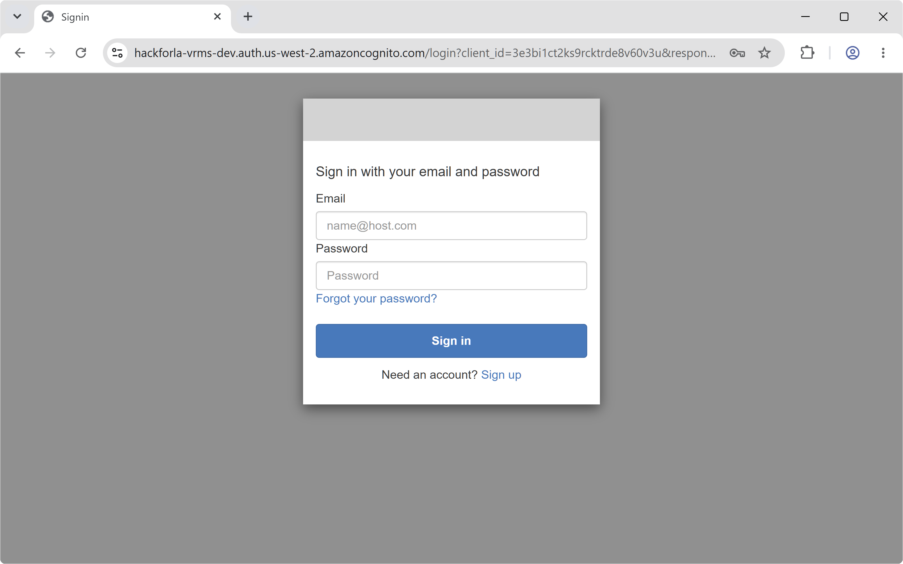{ width="500"}](images/cognito-login.png)

1. Copy the URL when it redirects. **Note:** Instead of the screen below, the screen may display an error message. You can ignore any error messages.

    [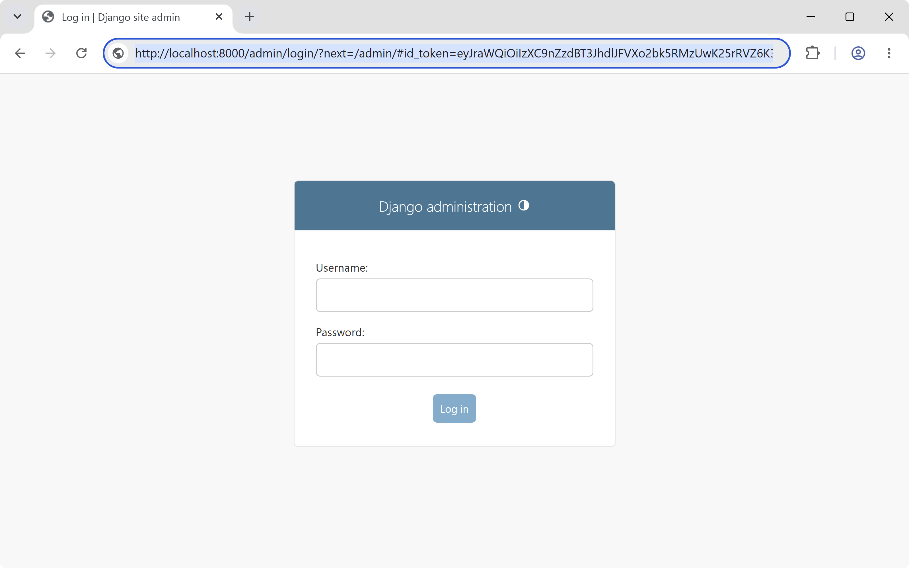{ width="500"}](images/cognito-redirect-url.png)

1. Extract the `access_token` using the [online tool](https://regexr.com/6ro69).

    1. Clear the top box and paste the URL text into it. The box should show there's 1 match
    1. The bottom box's content is the extracted `access_token`

    [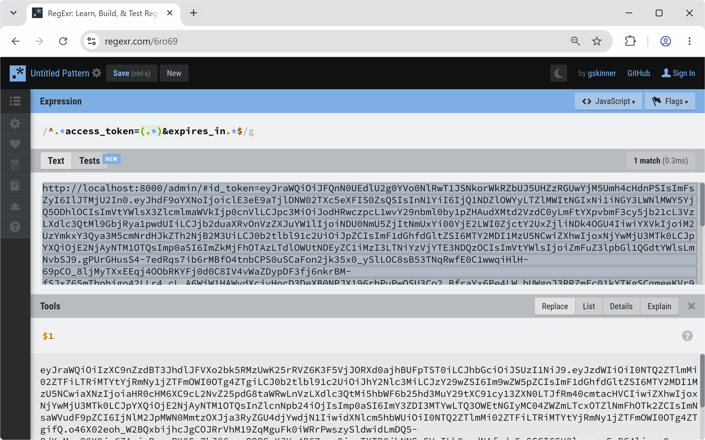{ width="500"}](images/regexr-token-extraction.png)

1. Choose and configure one of the following browser extensions to set the authorization header:

    === "HeaderSnap"

        Open the [HeaderSnap](https://headersnap.com/blog/override-response-headers-chrome/) extension. If the icon is not visible in your toolbar, the icon may be hidden. You can click on the puzzle icon to view your extensions and open it from the list (you can also pin it for easy access). Enter or choose the following:

        - Choose Request for `Header Target`
        - Choose glob for the `Url Pattern` and enter `http://localhost:8000/api/*`
        - Enter "Authorization" under `Header`
        - Choose Set for `Action`
        - Under `Header Value` type "Bearer" and paste your token

        [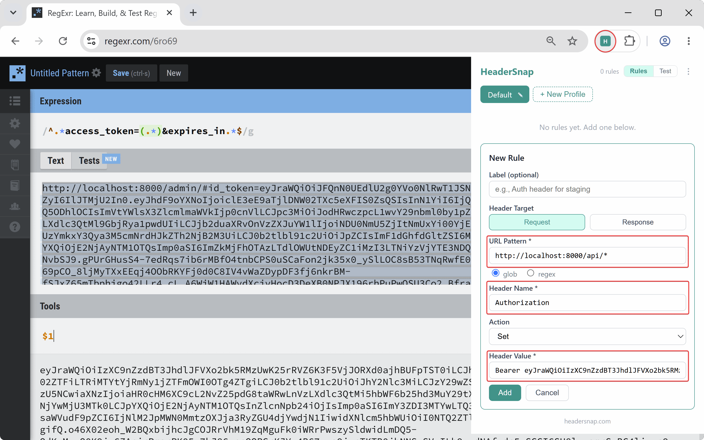{ width="500"}](images/headersnap-config.png)

    === "Modify Header Value (HTTP Headers)"

        1. Open the [Modify Header Value (HTTP Headers)](https://mybrowseraddon.com/modify-header-value.html) extension and click on Open Options Page.

            [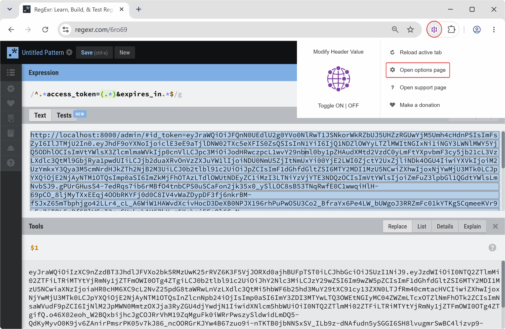{ width="500"}](images/modify-header-options.png)

        1. Input the following:

            - For `URL` type `http://localhost:8000/api/*`
            - Under `Header Name` type "Authorization"
            - Under `Header Value` type "Bearer" and paste your token
            - Click Add

            [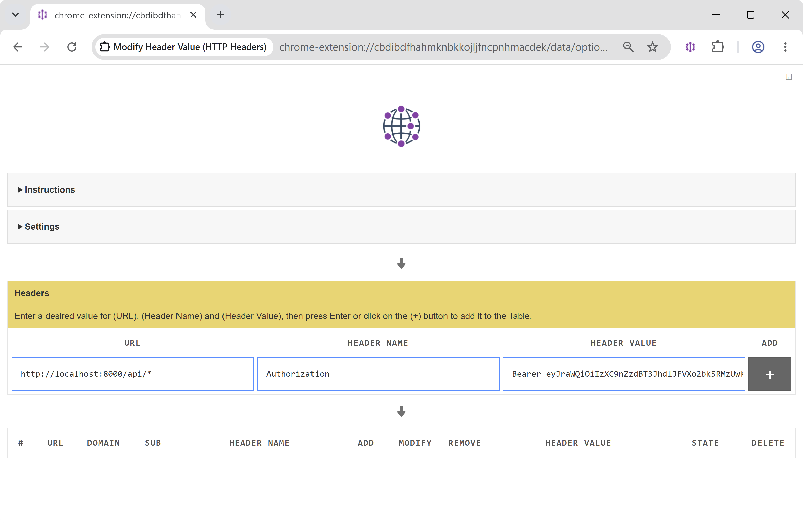{ width="500"}](images/modify-header-inputs.png)

        1. You will now see your entry below. The modification is automatically set to `ADD`, change it to `MODIFY`.

            [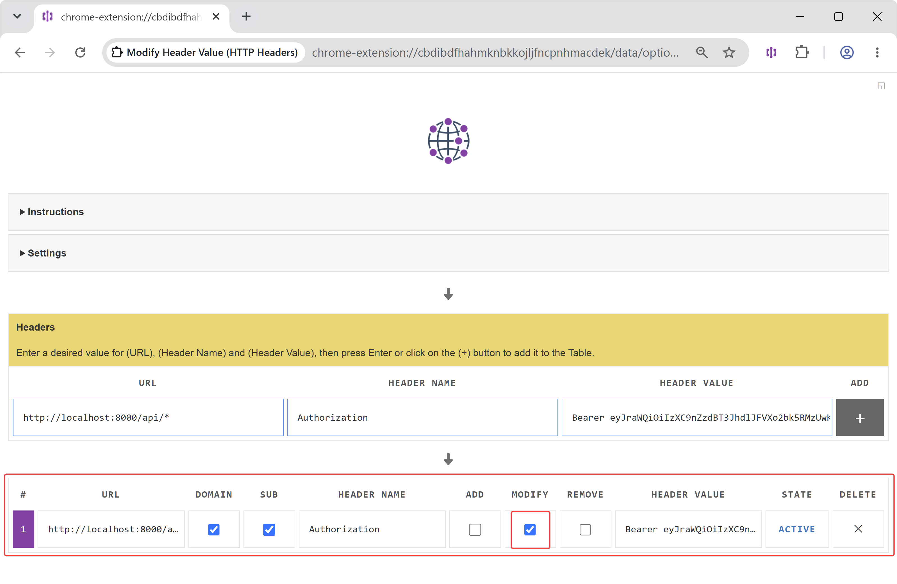{ width="500"}](images/modify-header-table.png)

        1. You can close the tab, but make sure the extension stays toggled *ON*

            [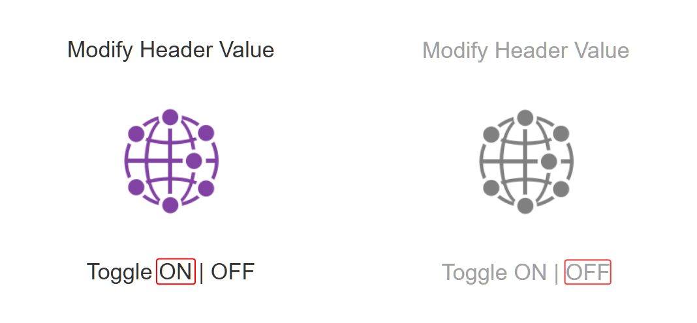{ width="250" style="margin-left: 125px;" }](images/modify-header-toggle-side-by-side.png)

1. Go to a page in api/v1/ to see that it allows access

    [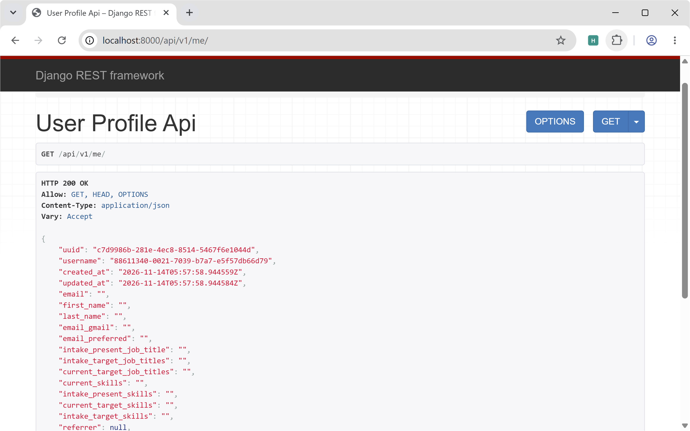{ width="500" }](images/api-access-verification.png)

1. Explore APIs using [Swagger](http://localhost:8000/api/schema/swagger-ui)

    [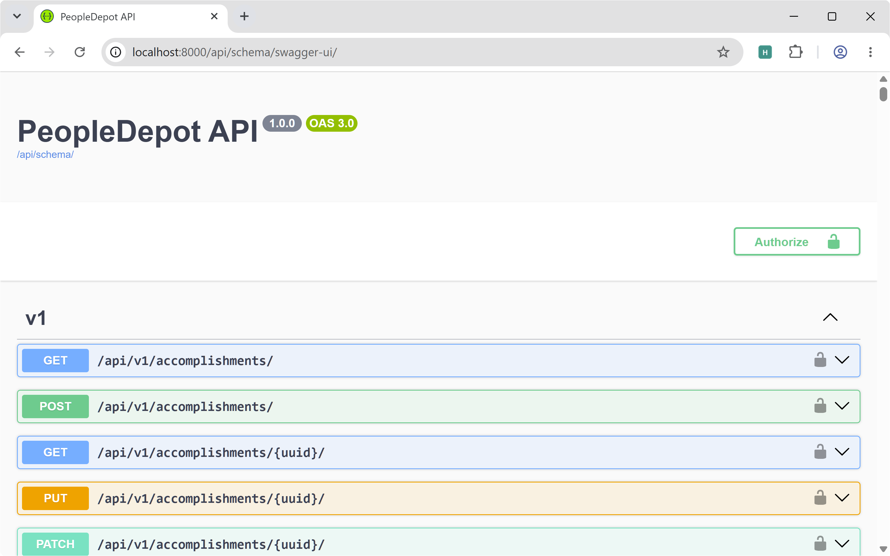{ width="500"}](images/swagger-ui.png)

1. Some fields have hints on how to retrieve the values.

    [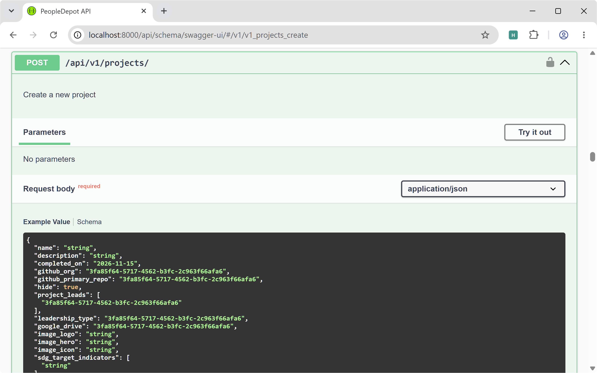{ width="500"}](images/swagger-hints.png)

1. A [ReDoc UI](http://localhost:8000/api/schema/redoc) is also available

    [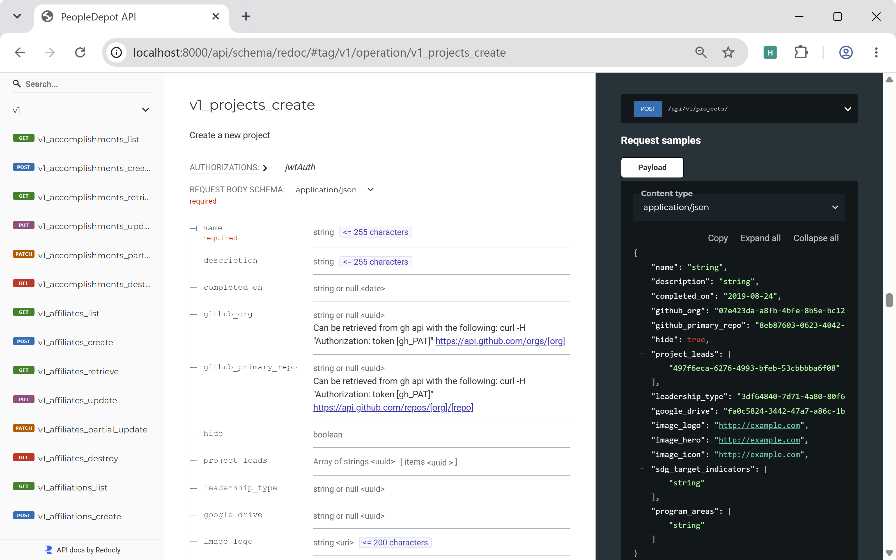{ width="500"}](images/redoc-ui.png)

1. **Disable the extension when finished testing.** If the URL pattern is not restricted to `http://localhost:8000/api/*`, the extension will modify headers across all outbound browser requests, which can cause authorization and CORS errors on other websites.
